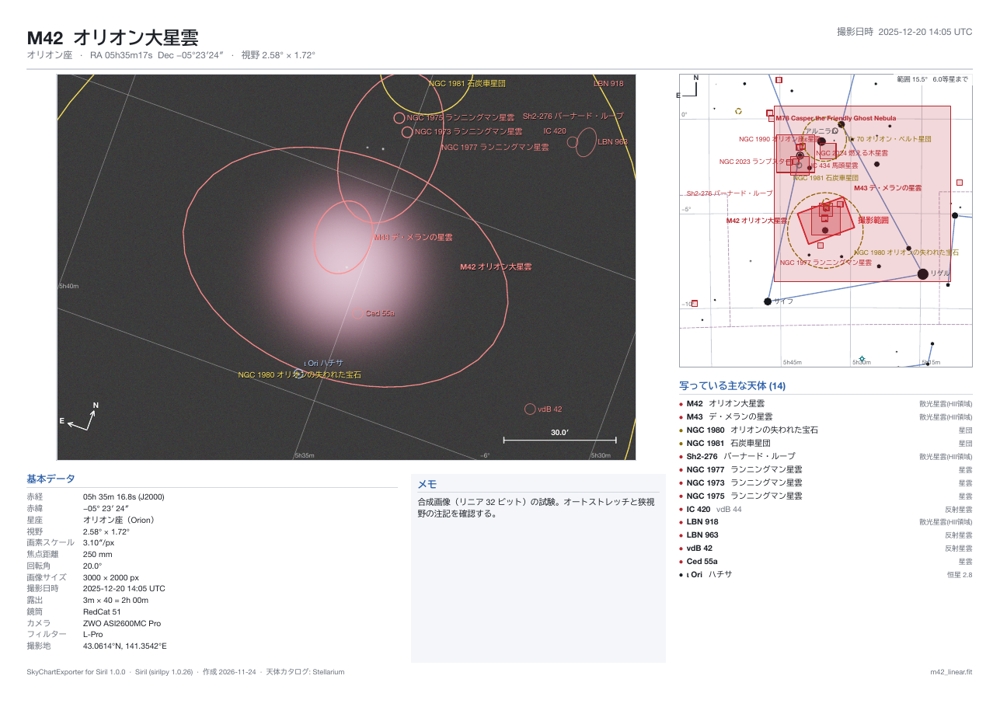

# SkyChartExporter for Siril

プレートソルブ済みの画像から、次の内容を **1枚の軽量な横長 PDF** にまとめて書き出す [Siril](https://siril.org/) 用 Python スクリプトです。PixInsight 用スクリプト [SkyChartExporter](https://github.com/Geology-cat/SkyChartExporter) を Siril に移植しました。

- アノテーションを書き込んだ写真（書き込み量はプリセットまたは個別に選択）
- 天球上の位置を示す星図（撮影範囲を赤枠で表示。星図の範囲は自由に指定）
- 基本データ（中心座標・星座・視野・画素スケール・焦点距離・回転角・撮影データ）
- 写っている天体とその種類の一覧
- メモ（ダイアログで記入）

日本語と英語に対応しています。日本語モードでは、日本語名がある天体（メシエ天体、主な NGC/IC 天体、Sh2・LBN などの通称付き天体、明るい恒星、88星座）は日本語で表示します。

> English: A Siril 1.4+ Python script that exports a plate-solved image as a one-page landscape PDF with an annotated photo, a sky chart showing the field, basic data, a list of catalogued objects and notes. Copy `SkyChartExporter.py` **and the `sce` folder** into a Siril script folder, run `reloadscripts`, then choose **Scripts → Python Scripts → SkyChartExporter**.



## 動作環境

- **Siril 1.4.0 以上**（同梱の Python 環境と sirilpy を使います）。macOS / Windows / Linux
- 初回実行時、Siril の Python 環境に不足している **PyQt6**（ダイアログと PDF 出力）と **astropy**（座標変換・星座判定）を自動で導入します（インターネット接続が必要なのはこのときだけです）。
- 使うデータは次のとおりです（すべてローカル）。

| データ | 用途 | 無い場合 |
|---|---|---|
| **Stellarium**（インストール済みのもの） | 星雲・星団・銀河 約9.5万天体とその種別・通称・日本語訳、**星座境界** | Siril 同梱カタログ（Messier・NGC・IC・Sh2・LDN 約1.5万天体）で動作。種別は Messier・Sh2・LDN のみ、星座境界は描けません |
| Siril 同梱データ（`share/siril/catalogue`） | 恒星名（約3,600星）・星座線・星座名の位置 | （必須・常にあり） |

Stellarium のデータは再配布せず、利用者の Stellarium から実行時に読むだけです。Stellarium は `/Applications/Stellarium.app`（Windows は `C:\Program Files\Stellarium`、Linux は `/usr/share/stellarium` や Flatpak）を自動で探します。別の場所にある場合はダイアログの「カタログ」欄で指定してください。

## インストール

`SkyChartExporter.py` と **`sce` フォルダ**を、同じ場所に置いたまま Siril のスクリプトフォルダにコピーし、Siril 下部のコマンド欄で `reloadscripts` を実行します（Siril の再起動でも反映されます）。

```
<スクリプトフォルダ>/
├── SkyChartExporter.py   ← 本体（メニューに表示される）
└── sce/                  ← 部品（Siril はサブフォルダを走査しないのでメニューには出ません）
```

| OS | 既定のスクリプトフォルダ |
| --- | --- |
| macOS | `~/Library/Application Support/org.siril.Siril/scripts` |
| Windows | `%APPDATA%\siril\scripts` |
| Linux | `~/.siril/scripts` または `~/siril/scripts` |

フォルダがなければ作成してください。好きなフォルダに置き、Siril の **環境設定 → スクリプト** でスクリプトの検索パスに追加する方法もあります。

**macOS のインストーラー:** `install.command` をダブルクリックすると上記フォルダにコピーします（既存の別バージョンはバックアップします）。ブラウザでダウンロードした場合は macOS にブロックされることがあるので、右クリック → **開く** を選ぶか、ターミナルで `zsh install.command` を実行してください。

**アンインストール:** コピーした `SkyChartExporter.py` と `sce` フォルダを削除し、`reloadscripts` を実行します。設定は Siril のユーザーデータフォルダの `SkyChartExporter` フォルダに保存されます。

## 使い方

1. Siril の「画像プレートソルバー」（`platesolve` コマンド）や [SkySolver](https://github.com/Geology-cat/siril-skysolver) などでプレートソルブした画像を **単独で** 開きます（シーケンスは対象外）。
2. **スクリプト → Pythonスクリプト → SkyChartExporter** を実行します。
3. ダイアログで設定して **プレビュー** で確認し、**PDFを書き出す…** で保存します。

設定は次回起動時に引き継がれます（タイトル・メモ・焦点距離/画素サイズの手入力は画像ごとの内容なので保存しません。画素サイズはカメラ名ごとに記憶します）。

### コマンドで使う（ダイアログなし）

Siril のコマンド欄・スクリプト（`.ssf`）・`siril-cli` から、`--out` を付けるとダイアログを出さずに書き出します。`siril-cli` では `--out` が無くても画像と同じフォルダ（画像が未保存なら Siril の作業フォルダ）に `<画像名>_skychart.pdf` を書き出します。

```text
pyscript SkyChartExporter.py --out ~/Desktop/m42.pdf --preset detailed --memo "1行目\n2行目"
```

| オプション | 内容 |
|---|---|
| `--out` | 保存先 |
| `--lang ja\|en` | 言語 |
| `--preset none\|minimal\|standard\|detailed\|all` | 書き込み量 |
| `--page A4\|A3\|Letter\|Wide`、`--theme light\|dark` | 用紙・配色 |
| `--stretch auto\|none\|linked\|unlinked` | 表示ストレッチ |
| `--title`・`--memo`・`--observer`・`--site`・`--font` | 文字（`\n` で改行） |
| `--dpi`・`--max-mb`・`--no-compress` | 写真の解像度と自動圧縮 |
| `--focal`・`--pixel` | 焦点距離 (mm)・画素サイズ (µm) |
| `--chart-fov` | 星図の範囲（度） |
| `--no-stellarium`・`--stellarium-dir` | Stellarium のカタログ |

指定しなかった項目は、ダイアログで最後に保存した設定を使います。

### 主な設定

| 区分 | 項目 | 内容 |
|---|---|---|
| ドキュメント | タイトル | 空欄なら写っている主な天体（例: `M42 オリオン大星雲`）から自動で付けます |
| | 撮影者・撮影地 | ヘッダーと基本データに表示します（撮影地が空なら、画像の緯度経度を表示） |
| | 用紙 | A4横 / A3横 / レター横 / ワイド16:9 |
| | 配色 | ライト（印刷向き）/ ダーク |
| | フォント | 自動（欧文フォント＋日本語フォント）または指定 |
| 画像と圧縮 | 表示ストレッチ | 自動（リニア画像なら Siril のオートストレッチ。8ビットの JPEG・PNG などはそのまま）/ なし / オートストレッチ（チャンネル連動・独立） |
| | 画像の解像度 | 写真部分の印刷解像度（初期値 200 dpi） |
| | 自動圧縮・目標サイズ | PDF が目標サイズ（初期値 2 MB）を超えたら、写真の解像度を下げて作り直します |
| | 焦点距離・画素サイズ | 0 なら自動（画素サイズが分からなければ視野から35mm判換算で推定）。画素サイズを入力するとカメラごとに記憶します |
| | 画像情報 | 検出したカメラ名・画素サイズ（とその出どころ）・焦点距離を表示します |
| アノテーション | 書き込み量 | なし / 最小 / 標準 / 詳細 / すべて（個別に変えると「カスタム」） |
| | 対象 | メシエ・コールドウェル・通称のある天体・NGC/IC（限界等級）・散光星雲・暗黒星雲・惑星状星雲・超新星残骸・散開星団・銀河（限界等級）・銀河団・恒星名（限界等級） |
| | 図形 | 星座線・星座境界・星座名・座標グリッド・方位とスケールバー |
| 星図 | 範囲 | 自動 / 画像視野の倍率 / 角度で指定 |
| | 表示 | 恒星の限界等級、星雲星団、星座線・境界・名前、グリッド |
| 天体一覧 | 最大件数 | 縦長の列に省略なしで表示。入りきらない分は「ほか N 天体」とまとめます |
| メモ | | 自由記入。基本データの横（または下）に折り返して表示します |
| カタログ | Stellarium | 使う/使わないと場所の指定（空欄なら自動） |

### 書き込み量プリセットの目安

| プリセット | 天体 | 恒星名 | 図形 |
|---|---|---|---|
| 最小 | メシエ・コールドウェル・通称のある天体 | 2.5等まで | 方位・スケール |
| 標準 | ＋ NGC/IC（12等まで）・散光星雲・散開星団・超新星残骸 | 4.5等まで | ＋ 星座線・グリッド |
| 詳細 | ＋ NGC/IC（14等まで）・暗黒星雲・惑星状星雲・銀河（14等まで） | 6等まで | ＋ 星座境界・星座名 |
| すべて | ＋ 銀河団、NGC/IC・銀河すべて | すべて | すべて |

NGC/IC 以外のカタログの多く（LBN・vdB・Barnard・PGC・Abell など）とコールドウェル天体は、Stellarium のカタログを使っているときだけ対象になります。Siril 同梱カタログだけのときは Sh2（散光星雲）と LDN（暗黒星雲）が対象です。

## PixInsight 版からの移植：使えるもの・使えないもの

PixInsight 版が使っている機能を一つずつ、Siril 1.4（sirilpy）とその Python 環境で何に置き換えられるかを精査しました。

| PixInsight 版で使っているもの | Siril 版での扱い | 判定 |
|---|---|---|
| アクティブな画像ウィンドウ | sirilpy で、Siril に読み込まれている単独の画像を読む（シーケンスは不可） | ○ 置き換え |
| 天測解による座標変換（`celestialToImage` など） | Siril が FITS ヘッダーに持つ WCS（TAN・TAN-SIP）を astropy で一括変換。起動時に Siril 自身の `pix2radec` と中心・四隅で照合し、0.5 画素以上ずれたら Siril の変換を1点ずつ呼ぶ方式に切り替える | ○ 置き換え |
| 天測解の要約（回転角・座標系） | WCS から計算。回転角は **Siril のプレートソルブ結果（Up is … deg CounterClockwise wrt. N）と同じ定義**、鏡像の判定も Siril と同じ（CD 行列の行列式） | ○（PixInsight の表示値とは定義が異なる） |
| FITS キーワード・XISF プロパティ | `get_image_fits_header` と `get_image_keywords`（Siril が解釈した撮影データ） | △ XISF 固有のプロパティは Siril が読み込み時に変換したものだけ |
| 撮影枚数（`NCOMBINE`） | Siril のスタックが書く `STACKCNT`・`LIVETIME` を読む（`NCOMBINE` も読む） | ○ |
| 現在の STF を適用 | Siril の表示状態（リニア/対数/平方根/asinh/ヒストグラム平坦化と上下限）は取得できても、表示用 LUT を正確に再現する API が無い | × → オートストレッチで代替 |
| 自動 STF | Siril のオートストレッチ（`get_image_pixeldata(preview=True)` で Siril 自身が計算。チャンネル連動/独立を選択） | ○ 置き換え |
| 画像の縮小（`resample`） | Qt の高品質縮小 | ○ |
| PDF 出力（`PDF`＋`Graphics`） | PyQt6 の `QPdfWriter`＋`QPainter`。PyQt6 は Siril の公式スクリプト集が新しい GUI スクリプトに求めているツールキット（[siril-scripts の README](https://gitlab.com/free-astro/siril-scripts)）。写真は JPEG 圧縮、ほかはベクター、フォントはサブセット埋め込み | ○ 置き換え |
| プレビュー用ビットマップ | `QImage`（PDF と同じ描画コード） | ○ |
| ダイアログ（PJSR） | PyQt6 の `QDialog` | ○ |
| 設定の保存（`Settings`） | Siril のユーザーデータフォルダに JSON で保存 | ○ |
| メニュー登録（Feature Scripts） | Siril のスクリプトフォルダに置く（スクリプト → Pythonスクリプト） | ○ |
| 同梱カタログ Messier・NGC-IC（種別・軸比・位置角つき） | Siril 同梱の `messier/ngc/ic.csv`（**種別・軸比・位置角なし**）。メシエ天体の種別だけ本スクリプトの表で補う | △ → Stellarium のカタログを推奨 |
| 同梱カタログ Caldwell・SNR（Green） | Siril には無い | × → Stellarium のカタログで代替 |
| Sh2・LDN | Siril 同梱の `sh2.csv`・`ldn.csv` | ○（PixInsight 版の同梱カタログより多い） |
| 恒星名（NamedStars） | Siril 同梱の `stars.csv`（約3,660星、固有名・バイエル/フラムスティード符号） | ○ |
| 星座線 | Siril 同梱の `constellations.csv` | ○ |
| 星座名の位置 | Siril 同梱の `constellationsnames.csv` | ○ |
| 星座境界 | **Siril には無い** → Stellarium の `skycultures/modern/index.json`（IAU 境界、B1875）を読み、astropy で J2000 に歳差補正 | △ Stellarium があれば ○ |
| 画像中心の星座の判定 | astropy の `get_constellation`（IAU 境界, Roman 1987） | ○ 置き換え |
| Stellarium の DSO カタログ・通称・日本語訳 | 同じ読み込み処理を Python に移植（gzip の展開は標準ライブラリ） | ○ |
| Gaia DR3（XPSD）で星図に暗い星まで描く | **Siril の Python API には任意の範囲で星表を検索する手段が無い**（`conesearch` コマンドは画像の範囲だけで、表示に注記を描く副作用がある。ローカル Gaia カタログを読む API も無い） | × → 同梱の恒星表（約3,600星・概ね6.5等まで）で描く |
| 日本語フォントの選択 | `QFontDatabase`。欧文フォントと日本語フォントを組み合わせ、PDF の文字コピー・検索で漢字が部首文字（大→⼤ など）に化けないことを確かめた BIZ UDゴシックなどを優先 | ○ |

## PDF の内容と軽さについて

- 写真以外（注記・星図・文字）は**ベクター**で描くため、拡大してもぼやけず、ファイルサイズにほとんど影響しません。PDF の文字は検索・コピーできます（フォントはサブセット埋め込み。macOS の BIZ UDゴシックで確認。ほかの OS で別のフォントが選ばれた場合、一部の漢字がコピー時に部首文字になることがあります。その場合はダイアログでフォントを指定してください）。
- PDF のサイズはほぼ写真の画素数で決まります。目標サイズを超えると、写真の解像度を自動で下げて作り直します（最大7回、下限 50 dpi）。それでも収まらない場合は警告を出します。
- 写真は Siril の表示と同じ向き（画素配列の 0 行目が下）で配置します。
- 書き出し結果（サイズ・写真の画素数・解像度）はメッセージと Siril のコンソールに表示されます。

## 基本データの見方

- **中心座標**: 画像中心の赤経・赤緯（天測解の座標系。通常は ICRS ≒ J2000）
- **星座**: 画像中心が属する星座（IAU の星座境界で判定）
- **焦点距離**: 下記「焦点距離について」を参照
- **回転角**: Siril のプレートソルブ結果と同じ定義（画像の上方向が北から反時計回りに何度か）。鏡像なら「（鏡像）」
- **撮影日時・露出・機材**: FITS キーワード（`DATE-OBS`, `EXPTIME`, `STACKCNT`/`NCOMBINE`, `LIVETIME`, `TELESCOP`, `INSTRUME`, `FILTER`, `SITELAT`/`SITELONG` など）のうち、あるものだけ表示します

### 焦点距離について

焦点距離は「だいたい分かれば十分」という考えで、次の順に求めます。基本データには、どの方法で求めたかを併記します。

1. ダイアログで手入力した焦点距離
2. 画像に記録された焦点距離（`FOCALLEN`）
3. 画素サイズが分かれば、画素スケールから算出（画素サイズは、手入力 → 画像の記録 `XPIXSZ` → 同じカメラで前回入力した値 → カメラ名からの推定、の順に探す）
4. それも無ければ、**視野から35mm判換算で推定**（例: 「約 59 mm（35mm判換算・視野から推定）」）

4 の換算は、対角の視野が同じになる35mm判（フルサイズ、対角 43.3 mm）のレンズの焦点距離です。

> 焦点距離 ≈ 43.3 mm ÷ (2 × tan(対角視野 ÷ 2))

APS-C や天体用の小さなセンサーで撮った画像では、実際の焦点距離より長めの値になります。実際の値を載せたい場合は、焦点距離か画素サイズを手入力してください。

### ページの割付

- **右列**: 星図（上）と、写っている天体の一覧（下、縦長）。一覧は文字を省略せず、名前が長いときは次の行に折り返します。入りきらない分は最後に「ほか N 天体」とまとめます。
- **左列**: 写真。基本データとメモは、横長の写真なら写真の下、縦長の写真なら写真の右に置きます（写真を大きく取れる方を自動で選びます）。

## 制限事項

- 星図の恒星は Siril 同梱の恒星表（約3,600星、概ね6.5等まで）だけです。PixInsight 版のように Gaia で暗い星まで描くことはできません（上の表を参照）。
- Stellarium が無い場合、天体は Siril 同梱のカタログ（Messier・NGC・IC・Sh2・LDN）だけになり、NGC/IC の種別は空欄、星座境界は描けません。
- 「現在の表示（STF）を適用」には対応していません。ストレッチ済みの画像は「なし」、リニア画像は「自動」かオートストレッチを選んでください。
- Siril は `SITELAT = '+43 03 41'` のような空白区切りの緯度経度を読み込み時に捨てるため、その形式の画像では撮影地の緯度経度を表示できません（度単位の数値なら表示します）。撮影地はダイアログで入力することもできます。
- 超広角の画像で「詳細」「すべて」を選ぶと、NGC/IC 天体や恒星名が非常に多く書き込まれます。広角では「最小」か「標準」、または NGC/IC の限界等級を下げるのがおすすめです（重なるラベルは自動的に省略されます）。
- 天体の位置・大きさ・種別は各カタログの値です。Stellarium の LDN・LBN などの「等級」欄は不透明度・明るさの階級なので、等級による絞り込みには使っていません。
- 日本語名は、本スクリプトの辞書（国内で定着している名前）を優先し、無いものは Stellarium の日本語訳を使います。Stellarium の訳には直訳調で国内では一般的でないものも含まれます。日本語名が無い天体は英語の通称、またはカタログ番号で表示します。

## ファイル構成

| ファイル | 役割 |
|---|---|
| `SkyChartExporter.py` | 本体・起動処理（Siril への接続、コマンドの引数） |
| `sce/exporter.py` | Siril からの画像・WCS・撮影データの読み込みと書き出しの流れ |
| `sce/imageinfo.py` | 座標変換（astropy / Siril）、視野・回転角・焦点距離・撮影データ、写っている天体の判定 |
| `sce/catalog.py` | カタログの読み込みと統合（Stellarium / Siril 同梱）、星座判定 |
| `sce/stellarium.py` | Stellarium の DSO カタログ・通称・日本語訳・星座境界の読み込み |
| `sce/photo.py` | 写真のストレッチと表示向きへの変換 |
| `sce/model.py` | ページに載せる内容（天体の選別・自動タイトル・基本データ） |
| `sce/render.py` | ページ割付と描画、PDF 書き出しと自動圧縮 |
| `sce/dialog.py` | ダイアログ |
| `sce/options.py` | 設定の保存とプリセット |
| `sce/strings.py` | UI と PDF の文言（日本語/英語） |
| `sce/names.py` | 日本語名辞書（星座・恒星・星雲星団・天体種別） |
| `sce/cameras.py` | カメラ名 → 画素サイズの表 |
| `sce/astro.py` | 角距離・投影・座標の書式化などの計算 |
| `tests/` | 単体テストと Siril 実機テスト。手順は [tests/README.md](tests/README.md) |
| `VALIDATION.md` | 検証記録 |

## ライセンス・クレジット

MIT License（[LICENSE](LICENSE)）。本スクリプトは Siril 開発チームおよび Stellarium 開発チームとは無関係の非公式ツールです。

- 天体カタログ・通称・日本語訳・星座境界: 利用者がインストールした [Stellarium](https://stellarium.org/)（GPL）のデータを実行時に読みます（同梱・再配布はしていません）。
- 恒星名・星座線・Messier/NGC/IC/Sh2/LDN: [Siril](https://siril.org/) 同梱のカタログを実行時に読みます。
- 座標変換・星座判定: [astropy](https://www.astropy.org/)。
